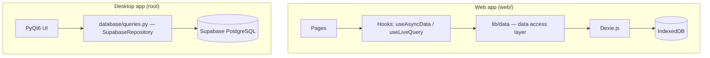

<div align="center">
  <h1>DevFlow</h1>
  <p><strong>Operations dashboard for freelancers: projects, finances, time tracking and investments in one place.</strong></p>

  <p>
    <a href="https://github.com/Mohamed-Sll/DevFlow/actions/workflows/ci.yml"></a>
    
  </p>

  <p>
    <a href="#features">Features</a> •
    <a href="#architecture">Architecture</a> •
    <a href="#quick-start">Quick Start</a> •
    <a href="#testing">Testing</a> •
    <a href="#documentation">Docs</a>
  </p>
</div>

---

## About

DevFlow helps a freelancer or small team run the day-to-day: which projects are active, what has been paid, where the money went, how many hours went into each client and how investments are progressing.

The repository contains **two independent clients**:

| Client | Stack | Data |
|---|---|---|
| **Web app** (`web/`) — main client | React 19, TypeScript, Vite, Tailwind CSS | Local-first, stored in the browser's IndexedDB through Dexie.js. No server, no account, works offline. |
| **Desktop app** (repository root) | Python 3.12, PyQt6 | Supabase (PostgreSQL). Packaged for Windows with PyInstaller. |

The two clients do not share data. The public web app has no login: each visitor's records stay in that browser profile, without upload, sharing, or sync across devices. Clearing browser storage can remove them, so export important records regularly. The web app replaced Supabase with IndexedDB in June 2026 (see [ADR-007](docs/decisions.md#adr-007-local-first-web-storage-with-dexie)); the desktop client still uses Supabase.

### Demo

- **Live demo:** coming soon (the previous Vercel deployment is offline).
- **Video walkthrough:** coming soon.

---

## Features

### Web app

| Area | What it does |
|---|---|
| Dashboard | Monthly revenue, expenses, balance and average ticket; 6-month revenue vs expenses chart; project status distribution; alerts for deadlines, bills due and overdue projects |
| Projects | CRUD with automatic client creation, total / paid / outstanding amounts, status filters, search, repository and staging links |
| Finances | Income and expenses with categories, filters by period, category and payment status, monthly charts |
| Timer | Start/stop per project, automatic duration, estimated billing from the project's hourly rate, session history |
| Investments | Assets with value and date goals, contributions, withdrawals and returns, progress per investment |
| Export | CSV, formatted Excel (ExcelJS) and PDF reports (jsPDF) |

### Desktop app

Dashboard, projects, finances, investments, timer and settings screens, with Excel and PDF exports (openpyxl, ReportLab) and a configurable backup folder.

---

## Architecture



Key decisions (full log in [`docs/decisions.md`](docs/decisions.md)):

- **Local-first web storage.** Dexie gives an async API over IndexedDB with no server, no environment variables and offline support. Pages only talk to `lib/data/`, so a remote backend can be added later without touching page code.
- **Single snapshot per page.** Each page loads one snapshot with everything it needs and computes derived values client-side, so totals always come from the same data.
- **Theming with CSS custom properties.** Colours live in `index.css` and switch through a `data-theme` attribute, avoiding duplicated `dark:` classes.

---

## Quick Start

### Web app

Requirements: Node.js 20+.

```bash
git clone https://github.com/Mohamed-Sll/DevFlow.git
cd DevFlow/web
npm install
npm run dev        # http://localhost:5173
```

No environment variables are needed.

| Command | Description |
|---|---|
| `npm run dev` | Development server |
| `npm run build` | Type check + production build |
| `npm run preview` | Preview the production build |
| `npm run lint` | ESLint |
| `npm run typecheck` | TypeScript type check |
| `npm run test` | Unit tests (Vitest) |

### Desktop app

Requirements: Python 3.12 and a Supabase project with the tables from [`docs/database.md`](docs/database.md).

```bash
python -m venv .venv
.venv\Scripts\activate            # Windows
pip install -r requirements.txt
copy .env.example .env            # then set SUPABASE_URL and SUPABASE_KEY
python main.py
```

`build.bat` packages the app into a Windows executable with PyInstaller (`devflow.spec`).

---

## Testing

| Suite | Command | Scope |
|---|---|---|
| Web | `cd web && npm run test` | Formatting, export and utility functions (Vitest) |
| Desktop | `pytest` | Excel and PDF report generation |
| Lint | `cd web && npm run lint` · `ruff check .` | ESLint for the web app, Ruff for the Python code |

CI ([`.github/workflows/ci.yml`](.github/workflows/ci.yml)) runs type check, lint, tests and build for the web app, and Ruff, a compile check and pytest for the desktop code on every push and pull request to `main`.

---

## Deployment

The web app is a static SPA and deploys to Vercel with no environment variables: root directory `web`, build `npm run build`, output `dist`. `web/vercel.json` adds SPA rewrites and security headers (CSP, HSTS, X-Frame-Options). Details in [`docs/deployment.md`](docs/deployment.md).

---

## Documentation

- [Architecture](docs/architecture.md) — web components, data flow and routing
- [Database](docs/database.md) — Supabase schema and RLS policies used by the desktop client
- [Deployment](docs/deployment.md) — Vercel setup and CI
- [Decision log](docs/decisions.md) — architecture decisions and their status
- [FAQ](docs/faq.md) — common questions about the web app

---

## Roadmap

- [ ] Redeploy the public demo
- [ ] End-to-end tests with Playwright
- [ ] Optional cloud sync for the web app (cross-device)
- [ ] i18n

---

## Contributing

See [CONTRIBUTING.md](CONTRIBUTING.md). Commits follow [Conventional Commits](https://www.conventionalcommits.org/).

## License

MIT — see [LICENSE](LICENSE).
